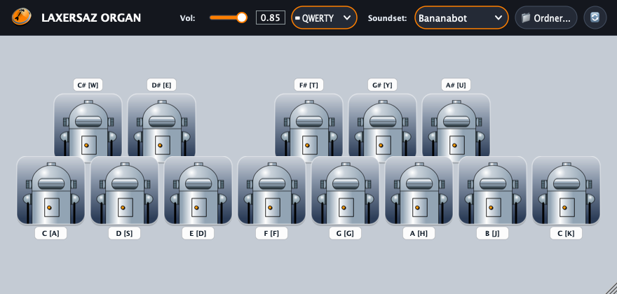

# Laxersaz Organ



A customizable 13-key toy organ audio plugin and standalone synthesizer (VST3, AU, LV2) built with JUCE.

## How to Play

* Mouse: Click or drag across any on-screen key.
* MIDI: Notes C4 to C5 (MIDI notes 60 to 72) trigger the 13 keys. Pitch bend wheel bends pitch (+/-2 semitones). Modulation wheel (CC 1) adds vibrato.
* Computer Keyboard: Focus the plugin window and play using your computer keyboard. Key badges show the assigned letter for each note. Use the layout selector in the header to switch between QWERTY, QWERTZ, and AZERTY.
* Volume: Adjust master output volume using the slider in the top bar.

## Soundsets

Select a soundset from the dropdown menu in the top bar. If a soundset has no samples, the built-in additive synth plays the notes.

To add custom soundsets:
1. Click the folder button in the top bar to open the soundsets directory (`~/Music/LaxersazOrgan/Soundsets/` on macOS/Linux, `%USERPROFILE%\Music\LaxersazOrgan\Soundsets\` on Windows).
2. Create a new subfolder with:
   * Audio: `01.wav` to `13.wav` for each note, or a single sample (e.g. `sample.wav`) pitched across the octave.
   * Images: `idle.png` (idle mascot) and `active.png` (singing/active mascot).
   * Key Color: Optional `color.txt` containing a hex color code (e.g. `#FFEAA7`).
3. Click the reload button to scan and load the new soundset.

## Installation

Download the release zip for your operating system and run the installer:

* macOS / Linux: Run `./install.sh` in the terminal. To uninstall: `./install.sh --uninstall`.
* Windows: Double-click `install.bat`. To uninstall: `install.bat --uninstall`.

The installer copies the plugin binaries to your system plugin directory and installs factory soundsets to your user Music directory. Reinstalling updates factory files and binaries while preserving any custom soundset folders you created.

## Building from Source

Requirements: CMake 3.22+, C++17 compiler (Xcode on macOS, Visual Studio on Windows, or GCC/Clang on Linux).

```bash
# Configure and build
cmake -B build -DCMAKE_BUILD_TYPE=Release
cmake --build build --config Release -j

# Install plugins and soundsets locally
cmake --build build --target install_user
```
